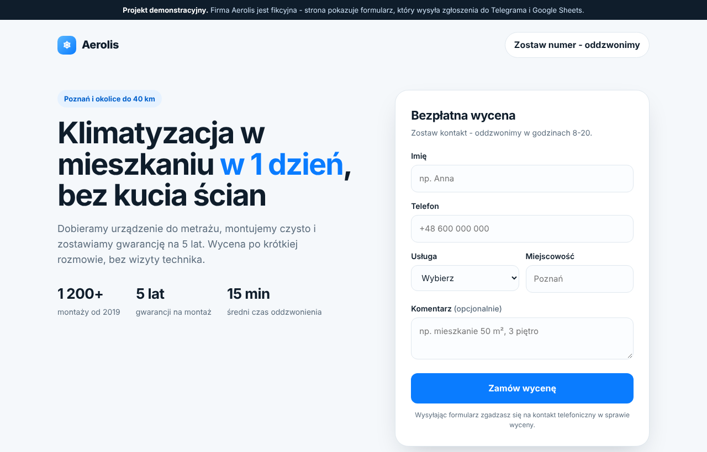

# Landing page with lead form → Telegram + Google Sheets

A one-page site for a local service business (demo: fictional air-conditioning company "Aerolis", Poznań).
Every form submission lands instantly in the owner's Telegram and as a new row in Google Sheets.



## What it does

- Responsive landing page: hero with form, benefits, prices, steps, FAQ
- Form validation in the browser and again on the server
- Lead goes to **Telegram** (formatted message) and **Google Sheets** (new row) at the same time
- If one channel is down, the other still receives the lead
- Spam protection with a hidden honeypot field
- Bot token and other secrets stay on the server, never in the page code
- Works without any setup in demo mode

## Stack

Plain HTML/CSS/JS, one serverless function (Node.js) on Vercel, Telegram Bot API, Google Apps Script. No frameworks, no database, free hosting.

## Run locally

```bash
node dev-server.js      # http://localhost:3000
npm test                # 14 tests
```

Without `.env` the form works in demo mode. To get real messages, copy `.env.example` to `.env` and fill in:

| Variable | Where to get it |
|---|---|
| `TELEGRAM_BOT_TOKEN` | create a bot with [@BotFather](https://t.me/BotFather) |
| `TELEGRAM_CHAT_ID` | send any message to [@userinfobot](https://t.me/userinfobot) |
| `GOOGLE_SHEETS_WEBHOOK` | optional, see below |
| `GOOGLE_SHEETS_SECRET` | any random string, same as in `Code.gs` |

Press **Start** in your bot once, otherwise Telegram won't let it message you.

## Google Sheets

1. Create a sheet → Extensions → Apps Script
2. Paste `apps-script/Code.gs`, change `SECRET`
3. Deploy → New deployment → Web app, access "Anyone"
4. Put the web app URL into `GOOGLE_SHEETS_WEBHOOK`

## Deploy to Vercel

1. Import this repository on [vercel.com](https://vercel.com) (no build settings needed)
2. Add the variables above in Settings → Environment Variables
3. Redeploy - the form now sends real leads

## Project structure

```
index.html            landing page and form script
api/lead.js           serverless function: validate → Telegram + Sheets
lib/lead.js           validation and message formatting
apps-script/Code.gs   Google Sheets receiver
dev-server.js         local preview without Vercel
tests/                node:test suite
```

The company, prices and numbers on the page are made up for the demo.
